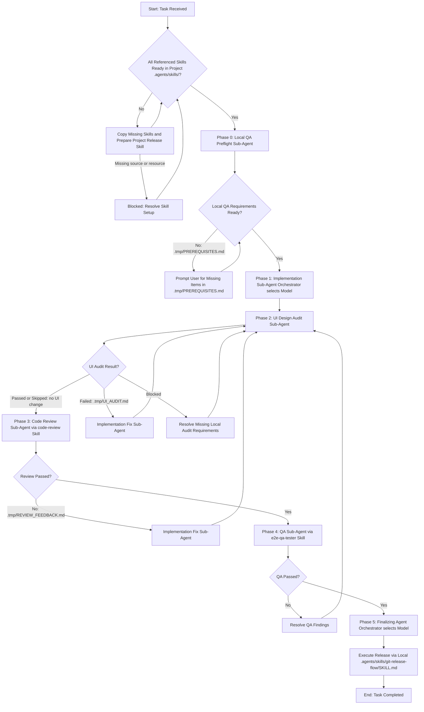

# Multi-Agent Delivery Pipeline Skill

This skill orchestrates multi-agent task execution while keeping the **Orchestrator Agent's context window ultra-lean**.

> [!IMPORTANT]
> **Host Tools and Model Selection**:
>
> - Keep the current orchestrator model. Select workers from models supported by the active host and delegation tool. Use a light model for simple checks, a balanced model for routine implementation and QA, and a stronger model for complex design or release work. Inherit the parent model when no override is needed.
> - Use the active host's delegation API and documented arguments. In Codex, use `collaboration.spawn_agent`, `followup_task`, `send_message`, and `wait_agent` when available. Follow the tool's model and context-fork restrictions. Do not invent tool names or parameters, or create user-owned chats as pipeline workers. If delegation is unavailable, report the blocked phase.

> [!IMPORTANT]
> **Project Skill Locality**:
> This pipeline and every skill it references MUST have a project-local copy under `.agents/skills/`. Initialize all referenced skills before Phase 0, using the Setup Phase below. Copy global sources; do not move or delete them.

> [!IMPORTANT]
> **Context Minimization & Orchestration Rules**:
>
> 1. **Zero Direct Inspection/Coding**: The Orchestrator MUST NOT inspect codebase files, read large outputs, or edit code directly.
> 2. **File-Based State Passing**: Sub-agents communicate details via temporary directory workspace files (e.g., `.tmp/PREREQUISITES.md`, `.tmp/UI_AUDIT.md`, `.tmp/REVIEW_FEEDBACK.md`, `.tmp/QA_REPORT.md`), returning ONLY status flags and file pointers to the Orchestrator.
> 3. **Workspaces**: Workers share files unless the host provides an isolated checkout. Reuse a suitable task checkout; create isolation when needed. Pass the exact checkout and evidence paths to each worker. Preserve unrelated changes. Before checking out of `main` or `master`, pull the latest changes successfully.
> 4. **Git Isolation**: Pipeline state files in the temporary directory (`.tmp/`) MUST NEVER be committed to Git at any point.
> 5. **Single Sub-Agent Execution**: At no point should two sub-agents be running concurrently or simultaneously. Each phase MUST be fully completed and verified before the Orchestrator launches the next sub-agent; strictly one sub-agent may be active at any time.

---

## Workflow Phases

### Setup Phase: Project Skills and Dependencies

Run before Phase 0, even when the pipeline already exists locally. Resolve all project paths from the active project checkout, not from the global skill directory.

Each skill referenced by this pipeline must have a local copy:

| Skill           | Project entrypoint                                      |
| --------------- | ------------------------------------------------------- |
| Pipeline        | `.agents/skills/multi-agent-delivery-pipeline/SKILL.md` |
| Code review     | `.agents/skills/code-review/SKILL.md`                   |
| End-to-end QA   | `.agents/skills/e2e-qa-tester/SKILL.md`                 |
| Project release | `.agents/skills/git-release-flow/SKILL.md`              |

1. **Reuse local skills**: Check every entrypoint above. Keep existing project copies and custom instructions. Do not overwrite them with global versions during setup.
2. **Copy missing skills**: Find each missing skill in the available skill catalog or configured global skill directories. Prefer the user's maintained global copy over a bundled duplicate. Copy the complete skill folder, including scripts, references, assets, and agent metadata, into `.agents/skills/<skill-name>/`. Keep the global source intact. Do not copy only `SKILL.md`, nest a second skill folder, or hardcode a machine-specific global path.
3. **Project release policy**: Reuse this project's release skill. If missing, copy a version explicitly intended for this project, or create it from the repository's documented release flow. Ask the user only for unresolved release-flow choices. Do not import another project's release policy or request publishing credentials during this setup.
4. **Verify and use local paths**: Check that each local `SKILL.md` and its referenced resources exist and are readable. Read local skill instructions before use. Pass the absolute project-local entrypoint to each delegated agent; resolve supporting resource paths from that skill's local folder. Do not select a global or bundled copy by name after setup. If a delegated agent uses another checkout, ensure the same local skill folders are available there.
5. **Missing dependency**: If a required skill or resource cannot be found or copied, report `STATUS: BLOCKED` with the missing item and required user action before Phase 0. Re-running setup must keep existing project files intact. Apply this setup to any additional skill referenced by the pipeline.

---

### Phase 0: Local QA Preflight (Delegated Sub-Agent)

Before implementation, establish how the completed feature will be tested locally on the current machine. The preflight agent must prepare the local requirements itself: dependencies, services, an isolated database, fixtures, and test accounts. Check what is available and resolve missing test requirements now, so the UI audit and QA phases can run. Local baseline checks and local QA are the default. Staging wording in an issue does not block local implementation; use staging only when the user explicitly requests it. A user's local-only instruction overrides issue staging requirements.

1. **Prerequisites Sub-Agent**: Orchestrator selects the model and launches the sub-agent before Phase 1.
2. **Local test plan**: Read the task and acceptance criteria. Identify the user flows and checks needed after implementation, and what each check needs. Use local testing unless the user explicitly requests another environment. For UI changes, identify affected screens, design references, viewport sizes, and browser access needed for Phase 2. Use existing project specifications, design tokens, shared components, and comparable app screens; a separate design file or external design account is not required by default. Capture a before screenshot before implementation when a before/after comparison will help explain the UI change. A before screenshot is optional; do not reconstruct one after implementation.
3. **Inspect the current machine and checkout**: Read project setup and test instructions, scripts, environment examples, and relevant local configuration. Check only what the planned tests need: runtimes and dependencies; services and databases; configuration and ports; test accounts and roles; seed data or fixtures; browser or API test tools; and any required integration access. Verify availability with lightweight checks, such as service connectivity, startup, or local login. Do not assume a file's presence proves that its configuration works. Do not require the unimplemented feature to pass yet.
4. **Resolve what the agent can prepare**: Reuse existing local setup and configured access. Install dependencies, start required services, prepare an isolated database, apply migrations, and create local role/tenant fixtures and test accounts within the task's authorization. Verify a runnable application and sign-in where the test plan needs them. Do not ask the user to perform setup that the agent can perform. Use mocks or test providers only when they preserve the required test coverage; do not replace a required integration check with a mock.
5. **Report**: Always write `.tmp/PREREQUISITES.md` for the UI Audit and QA agents. Include the local test plan, setup/start/test commands, required items, evidence for available items, and unresolved items. For each unresolved item, state which test it blocks and what the user must supply or do. Record configuration names and locations, never secret values.
6. **Gate**:
   - If the local test requirements are ready: return `STATUS: ALL_SATISFIED | File: .tmp/PREREQUISITES.md`. Proceed to Phase 1 without asking again for existing access or authorization.
   - If a required local item remains unavailable after attempted preparation: return `STATUS: MISSING_PREREQUISITES | File: .tmp/PREREQUISITES.md`. Before implementation, ask the user only for genuinely unobtainable local items, stating the preparation attempted and the specific blocked check. Missing staging access is not a local prerequisite. Recheck resolved items before proceeding.
   - If the task needs no running application, such as a skill-text change, record the relevant validation and why application setup does not apply.

**Scope**: Staging URLs, staging or production accounts, deployment access, and GitHub push/PR credentials are not default local QA prerequisites. Request external access only when a specific required test depends on it, after checking existing access and suitable local options. Access needed to read an issue is a task-input dependency; access needed to publish changes belongs to the release phase. Do not treat either as missing local QA setup.

Example request: "To test this feature locally in Phase 4, I need a sandbox provider account. The app and database are ready, but the callback test needs that account's credentials configured locally."

---

### Phase 1: Implementation

1. Orchestrator evaluates task scope and selects a supported sub-agent model under **Host Tools and Model Selection**.
2. Orchestrator launches **Implementation Sub-Agent** with the active host's delegation tool.
3. Sub-Agent executes changes in the assigned task checkout, writes summary to `.tmp/CHANGES.md`, and returns concise result: `STATUS: COMPLETE | File: .tmp/CHANGES.md`.
4. Before returning, run the applicable project-native format, lint, and test checks from preflight. Apply project `AGENTS.md` and release gates before committing. For skill or documentation-only changes, use relevant text validation unless project rules require more. Do not impose npm commands on a project that uses another build system. Fix violations; never add ignores, `eslint-disable` comments, or suppressions to pass a check.

---

### Phase 2: UI Design Audit (Conditional Gate)

Run immediately after implementation whenever the change affects rendered UI, content, layout, styling, or interaction, including changes to shared components. Apply this gate and the UI screenshot evidence requirements to actual UI changes, even if they were not planned or were added by a later fix. If the task has no UI changes, no UI screenshots are required; normal code review and relevant QA still apply. This is a separate visual and usability judgment, not a substitute for code review or functional QA.

1. **Independent audit**: Orchestrator selects a model with visual inspection capability and launches a **UI Audit Sub-Agent**, separate from the implementation agent. The agent reads `.tmp/CHANGES.md`, `.tmp/PREREQUISITES.md`, and the actual diff to confirm UI impact. If there is no UI impact, record the reason in `.tmp/UI_AUDIT.md` and return `STATUS: SKIPPED | File: .tmp/UI_AUDIT.md`. Missing tools or access are not reasons to skip a required audit.
2. **Design baseline**: Read the task's design specification and project UI guidance. Compare with the application's design tokens, shared components, and comparable existing screens. If no explicit design specification exists, use those project references and record the baseline. Judge against the application's design language, not personal taste. Resolve material conflicts in requirements with the user; do not redesign unrelated screens.
3. **Inspect the running local UI**: Use the preflight setup and browser tools to open each affected screen and exercise changed interactions. For shared UI changes, also inspect representative consuming screens. Inspect rendered screenshots; source inspection or automated layout checks alone cannot pass this gate.
4. **Judge the UI**:
   - **Specification and consistency**: Required content and states match the design specification. Typography, spacing, colors, components, icons, and navigation match the application, except where the task explicitly changes them.
   - **Clarity and usability**: Information order, labels, feedback, and actions make sense for the user's task. Controls remain readable, reachable, and usable with keyboard and touch where applicable. Follow project guidance for concise interface copy.
   - **Responsive layout**: Check phone, tablet, and desktop viewports within the supported range. Use project viewport guidance; otherwise choose representative sizes, such as 375, 768, and 1440 CSS pixels wide. Resize around relevant breakpoints. Check for overlap, clipping, unintended horizontal scrolling, unreadable text, and hidden or unreachable controls.
   - **Relevant states**: Inspect applicable loading, empty, populated, error, and open menu/dialog states. Include long labels or dense data where they could break the changed layout.
5. **Evidence**: Write `.tmp/UI_AUDIT.md` with the design references, inspected routes and states, viewport dimensions, screenshot paths, and findings. Capture result screenshots under **UI Screenshot Evidence** below. For each defect, record expected versus observed behavior, severity, reproduction steps, and the required correction. Separate optional design suggestions from failures of the stated criteria.
6. **Gate**: Return `STATUS: PASSED`, `STATUS: FAILED`, or `STATUS: BLOCKED`, always with `File: .tmp/UI_AUDIT.md`.
   - **PASSED**: Required visual checks are complete, with no unresolved defects against the criteria. Proceed to Phase 3.
   - **FAILED**: Launch an Implementation Fix Sub-Agent with the report, then repeat the UI audit on the updated local UI before proceeding.
   - **BLOCKED**: Record the missing requirement and affected checks. Resolve what the agent can prepare; ask the user only for what remains unavailable. Do not proceed on an unverified UI.

---

### Phase 3: Code Review (via `code-review` Skill)

1. Orchestrator determines review complexity, selects model tier, and launches **Code Review Agent** with the active host's delegation tool, explicitly loading and executing the project-local `.agents/skills/code-review/SKILL.md`.
2. Pass this constraint explicitly to the Code Review Agent: inspect both Standards and Spec in sequence; do not launch concurrent child agents, even if the review skill suggests parallel work. The agent audits diffs directly in the checkout and writes findings to `.tmp/REVIEW_FEEDBACK.md` following the other `code-review` guidelines. A change that adds `.prettierignore` entries, `eslint-disable` comments, or `eslint-suppressions.json` entries fails review.
3. Code Review Agent returns concise response: `STATUS: PASSED` or `STATUS: FAILED | File: .tmp/REVIEW_FEEDBACK.md`.
4. **Loop Evaluation**:
   - **FAILED**: Orchestrator launches new **Coding Sub-Agent** (model selected per feedback scope) pointing to `.tmp/REVIEW_FEEDBACK.md`. Recheck Phase 2 for UI impact from the fix, then repeat Phase 3. A fix without UI impact may retain the prior UI audit result; a UI-affecting fix must be audited again.
   - **PASSED**: Proceed to Phase 4.

---

### Phase 4: QA Verification (via `e2e-qa-tester` Skill)

1. Orchestrator selects model tier and launches **QA Agent** with the active host's delegation tool, explicitly loading and executing the project-local `.agents/skills/e2e-qa-tester/SKILL.md`.
2. QA Agent reads `.tmp/PREREQUISITES.md` and uses its local setup and test plan to execute end-to-end user simulation and QA verification via the `e2e-qa-tester` skill. Carry the local scope into that skill; do not default to staging. If implementation adds test requirements, update the report and resolve them before QA. Pass this cleanup constraint explicitly: preserve required reports, logs, and screenshots for review and handoff before cleanup, even if the QA skill requests immediate deletion. Delete only expendable task-owned resources; never delete the only evidence copy.
3. **UI changes only**: Capture process screenshots during the changed user workflow, following **UI Screenshot Evidence** below. Link them and the UI audit result screenshots in `.tmp/UI_EVIDENCE.md`. For tasks with no UI changes, mark screenshot evidence not applicable; do not require browser capture solely for this evidence package.
4. Write results to `.tmp/QA_REPORT.md`. Return `STATUS: PASSED` only when the required checks pass and, for UI changes, the required screenshots are captured. Otherwise return `STATUS: FAILED` or `STATUS: BLOCKED` with the report path; resolve failures or missing requirements before Phase 5. If fixes change code, repeat code review and the affected QA checks; repeat the UI audit and refresh affected screenshots when the fixes affect UI.

---

### Phase 5: Finalizing (Documentation & Project Git Release)

1. Orchestrator selects model tier and launches **Finalizing Agent** with the active host's delegation tool.
2. Finalizing Agent updates/writes codebase documentation.
3. **UI evidence handoff, only for UI changes**: Preserve the final screenshot package as specified below, verify that its images and report open, and return their durable paths to the Orchestrator. If evidence cannot be preserved or delivered, report `STATUS: BLOCKED` and the exact missing requirement; do not claim the handoff is complete.
4. **Project Git Release**: Read and execute the project-local `.agents/skills/git-release-flow/SKILL.md` prepared during setup. If it is missing or incomplete, resolve it through the Setup Phase before release. Skill setup does not grant permission to publish, merge, or deploy beyond the user's request.
5. Return a concise completion summary to the Orchestrator. For UI changes, the Orchestrator must show the key result and process screenshots in the final user reply and link the complete evidence report. Use inline images when supported, otherwise accessible image links. Do not deliver only an internal file pointer or a claim that screenshots exist.

---

## UI Screenshot Evidence (UI Changes Only)

Collect evidence during the UI audit and QA; deliver it when the task is complete. This is not a separate phase. Apply it only when the task changes UI, as determined in Phase 2.

- **Result screenshots**: Show the completed changed UI on desktop and mobile, plus any distinct tablet layout tested by the UI audit. Include a before/after comparison when a useful baseline was captured.
- **Process screenshots**: Show the user's starting screen, main action or intermediate step, and final result or confirmation. Include relevant error states exercised by QA. For a display-only change, show navigation to the changed screen and its displayed result; do not invent an interaction. These are screenshots of the user's application workflow, not agent activity, source code, or terminal logs.
- **Captions and report**: In `.tmp/UI_EVIDENCE.md`, identify the tested revision, link the UI audit and QA results, and group the screenshots by result and process. Caption each image with the route or screen, step, viewport dimensions, expected result, and observed result. One image may support both groups. Screenshots supplement test results; they do not replace functional checks.
- **Authentic and current evidence**: Capture the actual running local application. Do not generate mockups or use old images as proof of the final implementation. Prefer safe test data; exclude secrets and personal data, and disclose any redaction. After fixes, recapture affected steps so final evidence matches the delivered UI. Keep failed-attempt images separate and clearly labeled.
- **Storage and retention**: Keep working reports and images under `.tmp/` and out of Git. Before the final handoff, preserve the report, relevant test results, and images together in available persistent task-artifact storage or another authorized directory outside a disposable checkout. Update links to that location and verify them. Do not publish or upload evidence to a new external service without authorization. If no durable destination is available, report the blocker and retain the working copy. Never clean up or archive the only copy of required evidence.

---

## Context Efficiency Rules

- **Minimal Payloads**: `send_message` and sub-agent return prompts must contain < 200 words.
- **Offload Logs**: Large outputs, diffs, and test logs remain written to disk/artifacts, never echoed into the Orchestrator context.
