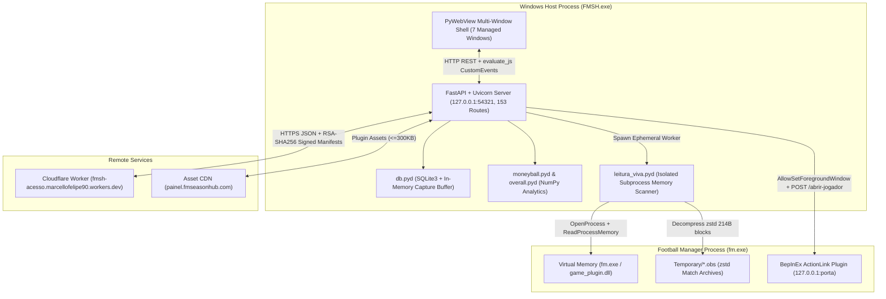

# FM Season Hub (v0.8.2.1) — Complete Reverse Engineering Report

> [!NOTE]
> Analysis executed with [rea-agents](https://github.com/morluto/rea) (`v6.7.0`, `morluto/rea`) across four domains:
> - **Setup & Extraction**: Inno Setup / PyInstaller / Nuitka unpacking and initial survey
> - **Architecture, UI, DB & Analytics**: [01-architecture-ui-db-analytics.md](docs/01-architecture-ui-db-analytics.md)
> - **Game Memory, Offsets & Plugins**: [02-memory-reader-offsets-plugins.md](docs/02-memory-reader-offsets-plugins.md)
> - **Network API, Auth & Diagnostics**: [03-network-auth-diagnostics.md](docs/03-network-auth-diagnostics.md)

---

## Repository Structure & Evidence Index

```
.
├── README.md
├── docs/
│   ├── 01-architecture-ui-db-analytics.md       # Architecture, FastAPI routes, SQLite schemas, Moneyball math
│   ├── 02-memory-reader-offsets-plugins.md      # Win32 RPM engine, player layouts, offsets, BepInEx hot-swapping
│   └── 03-network-auth-diagnostics.md           # Cloudflare Workers, device fingerprinting, RSA verification
└── evidence/
    ├── offsets.json                             # Extracted embedded signatures & trait maps (ASSINATURAS/TRACOS)
    ├── endpoints.json                           # 153 extracted REST/RPC endpoints
    ├── moneyball_catalog.json                   # 706 position metrics & weighting formulas
    ├── moneyball_rotulos.json                   # Metric labels & display categories
    ├── moneyball_siglas.json                    # Position abbreviation mappings
    ├── presets_fabrica/                         # Pre-configured Moneyball scouting roles
    └── decompiled_pyc/                          # Python 3.14 bytecode disassemblies (20 core modules)
```

---

## 1. Target Binary & Packaging Profile

| Property | Value |
| :--- | :--- |
| **Source Page** | `https://fmseasonhub.com/en/download` |
| **Installer Endpoint** | `https://painel.fmseasonhub.com/baixar` |
| **Installer Binary** | `FM Season Hub Setup.exe` (`44,926,289` bytes / 42.85 MiB) |
| **SHA-256** | `3977449795368e1af6d4b5599b7ca4664e5db49fdbe29e488f60c91b4d56fb80` |
| **MD5** | `5639b631efcd2bf32840bac16276948b` |
| **Outer Packaging** | Inno Setup `6.7.0` (Unicode), AppId `{7081324C-BDD5-4E77-B3D1-05C7DEDBC360}` |
| **Inner Packaging** | PyInstaller wrapping **Python 3.14 (AMD64)** (`1,945` extracted files) |
| **Core Engine Compilation** | **Nuitka Ahead-of-Time (AOT)** C11 extensions (`84` `.cp314-win_amd64.pyd` binaries) + `1,513` `.pyc` bytecode modules |
| **Desktop Shell** | `PyWebView` (Microsoft Edge WebView2 + Python.NET CLR bridge + custom `ctypes` Win32 windowing) |
| **Frontend Bundle** | React 18 + Vite SPA (`index-Cvmv7E2F.js`, 1.37 MB; recovered endpoints in [evidence/endpoints.json](evidence/endpoints.json)) |

---

## 2. System Architecture & IPC Flow



### Startup & Window Management ([evidence/decompiled_pyc/app_main.dis.txt](evidence/decompiled_pyc/app_main.dis.txt))
1. **Single-Instance Mutex**: Acquires Win32 mutex `FMSH_SINGLE_INSTANCE_MUTEX`. If `ERROR_ALREADY_EXISTS (183)`, focuses the existing window via `user32.dll` and exits.
2. **Loopback Server Binding**: Binds FastAPI (`server.cp314-win_amd64.pyd`) to `127.0.0.1:54321` (or a random free port) and writes the chosen port to `%LOCALAPPDATA%\...\porta.txt` so in-game BepInEx plugins can discover the desktop app.
3. **7 Managed Windows**:
   - `principal` (`1440x900` main React workstation)
   - `caixa` (modal splash/updater)
   - `menu_jogo` & `dados_jogo` (frameless in-game HUD overlays positioned over `fm.exe`)
   - `aviso_captura` & `aviso_conexao` (rounded pill notification banners via `dwmapi.dll`/`gdi32.dll`)
   - `menu_bandeja` (custom system tray flyout via `Shell_NotifyIconW` in [evidence/decompiled_pyc/bandeja.dis.txt](evidence/decompiled_pyc/bandeja.dis.txt))
4. **Bidirectional Event Bridge**:
   - **Frontend $\to$ Backend**: 153 REST endpoints (`/api/snapshots`, `/api/capture`, `/api/moneyball/browse`, `/api/jogo/abrir-jogador`, etc.).
   - **Backend $\to$ Frontend**: Invokes `janela.evaluate_js()` to dispatch DOM events (`fmsh-pedido-do-jogo`, `window.__fmshMostrarPainel`, `window.__fmshConectar`).

---

## 3. Game Memory Reading Engine & Struct Layouts

### 3.1 FM24 vs FM26 Process Architecture (`fm_memory.cp314-win_amd64.pyd`)
- **FM24**: Monolithic `fm.exe` (~120 MB PE32+) contains all engine code and global pointers.
- **FM26**: Unity 6 stub `fm.exe` (~692 KB) loads the native engine inside `game_plugin.dll` (~491 MB on Steam, ~493.7 MB on Xbox/Microsoft Store). `fm_memory` queries `VerQueryValueW` on `game_plugin.dll` (e.g., `26.3.2+2329565`) rather than `fm.exe` (which returns the Unity build string `6000.0.52f1-fm26-05f1`).
- **Containerized Sandbox Fallback**: Opens the process with `PROCESS_VM_READ | PROCESS_QUERY_INFORMATION (0x0410)`. If `EnumProcessModulesEx` is blocked by Xbox Game Pass / `WindowsApps` container restrictions, falls back to `CreateToolhelp32Snapshot(TH32CS_SNAPMODULE | TH32CS_SNAPMODULE32, pid)`.
- **Auto-Flipping Store Detection**: Determines `steam` vs `store` RVA tables via `game_plugin.dll` file size and path, then validates by reading `savegame_id` and `game_date`. If both read `0x0`, automatically swaps between `steam` and `store` RVA tables.

### 3.2 Global Root Pointer Traversal & RVAs ([evidence/offsets.json](evidence/offsets.json))
All entity tables use a uniform 2-level vector indirection from `game_plugin.dll` base:
$$\text{Root} = *(\text{ModuleBase} + \text{ROOT\_RVA}), \quad \text{Container} = *(\text{Root} + \mathtt{0x80})$$
$$\text{Begin} = *(\text{Container} + \mathtt{0x00}), \quad \text{End} = *(\text{Container} + \mathtt{0x08}), \quad N = \frac{\text{End} - \text{Begin}}{8}$$

| Constant (FM26 `26.3.2+2329565`) | RVA Offset | Target Entity Table / Object |
| :--- | :--- | :--- |
| `PERSON_ROOT_RVA` | `0x04E495E0` | All persons (players, staff, officials) |
| `CLUB_ROOT_RVA` | `0x04E49588` | All football clubs |
| `TEAM_ROOT_RVA` | `0x04E49610` | All squads (Senior, Reserves, U21, U18) |
| `COMP_ROOT_RVA` | `0x04E495A8` | All competitions/leagues |
| `CURRENCY_ROOT_RVA` | `0x04E49590` | Exchange rate table |
| `MGR_HNP_RVA` | `0x04E360F8` | Active human manager pointer |
| `SAVEGAME_ROOT_RVA` | `0x04E35F60` | Savegame metadata & session ID |
| `GAME_DATE_RVA` | `0x04DF3C18` | In-game calendar date |
| `ARQUIVO_PARTIDAS_RVA` | `0x045BEE18` | Match `.obs` archive index manager |

### 3.3 Player Object Layout & 720-Byte Bulk Read (`fm_reader.cp314-win_amd64.pyd`)
Instead of ~90 `ReadProcessMemory` syscalls per player, `FmReader.player_block()` reads a contiguous **720-byte slice (`0xF8..0x3C7`)** in one syscall and unpacks fields locally. Dual-role player/staff objects (`VT_PLAYER_STAFF_RVA = 0x04785848`) apply an athlete bias of `abias = -0xF8`:

| Field | Pure Player Offset | Player-Staff Offset (`-0xF8`) | Type | Notes |
| :--- | :--- | :--- | :--- | :--- |
| `VTABLE_PTR` | `+0x00` | `+0x00` | `uint64` | Polymorphic class discriminator |
| `INTERNAL_ID` | `+0x10` | `+0x10` | `uint32` | Via `*(PersonBase + 0x08)` |
| `BIRTH_DATE` | `+0x48` | `+0x48` | `uint32` | Julian / FM epoch date |
| `CURRENT_TEAM_PTR` | `+0x50` | `+0x50` | `uint64` | Pointer to `Team` struct |
| `FEMALE_FLAG` | `+0x58` | `+0x58` | `uint8` | `0` = Male, `1` = Female |
| `TRAIT_BLOB` | `+0x60` | `+0x60` | `bytes[32]` | Player traits bitmask |
| `INJURY_LIST` | `+0xB0` | `+0xB0` | `uint64` | Active injury vector |
| `NATION_PTR` | `+0xC0` | `+0xC0` | `uint64` | Nationality struct pointer |
| `CONTRACT_PTR` | `+0xC8` | `+0xC8` | `uint64` | Wage (`+0x150`), expiry (`+0x40`), loan (`+0x100`) |
| `STATS_PTR` | `+0x108` | `+0x108` | `uint64` | Current season aggregate statistics |
| `CAREER_STATS` | `+0x188` | `+0x188` | `uint64` | Historical career statistics |
| `MORALE` | `+0x22E` | `+0x136` | `uint8` | Morale enum (`0..20`) |
| `CURRENT_ABILITY` | `+0x264` | `+0x16C` | `uint16` | CA (`1..200`) |
| `POTENTIAL_ABILITY` | `+0x266` | `+0x16E` | `uint16` | PA (`1..200`) |
| `PERSON_UID` | `+0x294` | `+0x19C` | `uint32` | Persistent database UID |

### 3.4 Unobserved Match Form Recovery via `.obs` Zstd Archives (`arquivo_partidas.cp314-win_amd64.pyd`)
> [!TIP]
> Football Manager only populates in-memory `player_form` for players scouted by the user. To capture game-by-game ratings and stats for all ~270,000 players worldwide, FMSH reads `ARQUIVO_PARTIDAS_RVA` (`0x045BEE18`), locates `%LOCALAPPDATA%\Sports Interactive\Football Manager 2026\Temporary\<name>.obs`, skips the 8-byte header, decompresses the **Zstandard (`zstd`)** stream, and parses **214-byte participant blocks** (`+0x00` internal ID, `+0x0C` pitch position bitmask, `+0x87` rating $\times 100$) joined against `JOGO_VTABLE_RVA` (`0x04332188`).

### 3.5 Subprocess Heap Isolation & Parallel Batching
- **`leitura_viva.cp314-win_amd64.pyd`**: Spawns an isolated worker process for full memory scans so that when the scan finishes and flushes to SQLite, process termination immediately returns ~237 MB of fragmented CPython `pymalloc` heap pages to Windows.
- **`leitura_paralela.pyc`**: Chunks player pointers into batches of `2,000` across a `multiprocessing.Pool('spawn')` up to `os.cpu_count()`.

---

## 4. Database, Moneyball Analytics & Overall Rating Formulas

### 4.1 SQLite Persistence (`db.cp314-win_amd64.pyd`)
- Stages live captures in `:memory:` and flushes atomically to `fm26_snapshots.db` / `fm24_snapshots.db`.
- **17 Core Tables** with `ON DELETE CASCADE`: `snapshots`, `players`, `player_stats` (60+ Moneyball columns), `player_profile` (47 attributes + contract/biography), `player_match_stats` (`WITHOUT ROWID`), `team_match_stats` (`WITHOUT ROWID`), `player_form`, `snapshot_ligas`, `club_profile`, `teams`, `player_teams`, `youth_teams`, `youth_comps`, `youth_team_comps`, `comps`, `club_leagues`, `future_transfers`.

### 4.2 Vectorized Moneyball Engine (`moneyball.cp314-win_amd64.pyd` & [evidence/moneyball_catalog.json](evidence/moneyball_catalog.json))
- Evaluates **706 total derived metrics** across 7 position groups (`gk`: 87, `def`: 105, `wing`: 101, `dm`: 98, `b2b`: 105, `amc`: 105, `att`: 105).
- Computes exact mid-rank percentiles via `np.searchsorted`:
$$P = \frac{\text{count}(x < v) + 0.5 \cdot \text{count}(x = v)}{N} \times 100$$
For metrics flagged `"lowerBetter": true`, the score is inverted ($100 - P$).

### 4.3 Overall Rating System (`overall.cp314-win_amd64.pyd`)
Supports 3 modes: `atributos` (100% attributes), `estatistica` (100% match performance), and `misto` (50%/50% default):
1. **Attribute Rating (`anotas_atributo`)**:
   - Excludes unrevealed (`0`) attributes (masked scouting) if revealed weight coverage $\ge 70\%$ (`COBERTURA_MINIMA = 0.70`).
   - Normalizes weighted average $W_{\text{eff}}$ via truncated Z-score calibrated over 247,518 FM players ($\mu \approx 9.8, \sigma \approx 1.2, Z_{\text{corte}} = 3.0$):
   $$\text{Score}_{\text{attr}} = \text{clamp}\left(50 + \frac{W_{\text{eff}} - \mu}{3.0 \cdot \sigma} \times 50,\ 0,\ 100\right)$$
2. **Performance Rating (`anotas_desempenho`)**:
   - Requires $\ge 900$ minutes (`MINUTOS_MINIMOS = 900`).
   - Evaluates **19 tactical roles** (e.g., `paredao`, `goleiro_linha`, `zagueiro_agressor`, `zagueiro_construtor`, `ala_ofensivo`, `volante_destruidor`, `volante_criador`, `box_to_box`, `meia_armador`, `meia_goleador`, `ponta_driblador`, `ponta_finalizador`, `finalizador`, `atacante_pressao`, `atacante_criativo`) and selects the maximum weighted percentile score across candidate roles for the player's position group.

---

## 5. FM ActionLink, BepInEx Plugins, Cloud API & Security Architecture

### 5.1 FM ActionLink ([evidence/decompiled_pyc/abrir_no_jogo.dis.txt](evidence/decompiled_pyc/abrir_no_jogo.dis.txt))
- Reads `%USERPROFILE%\Documents\FM Season Hub\porta_do_jogo.json` written by the in-game BepInEx plugin `FMActionLink.FMSH`.
- Verifies target PID image name is `fm.exe` via `QueryFullProcessImageNameW`.
- Calls `user32.AllowSetForegroundWindow(pid)` so Football Manager can bring itself to the foreground, then sends `POST http://127.0.0.1:{porta}/abrir-jogador?uid={uid}&save={savegame_id}`.

### 5.2 BepInEx Plugin Hot-Swap & Rollback (`plugins_atualizador.cp314-win_amd64.pyd`)
- Manages 6 Unity/BepInEx plugins (`FMActionLink.FMSH`, `FMActionLink.Kits3D`, `FMActionLink.Stadiums3D`, `TacticalCam`, `PitchHUD`, `EasyTrainingTalks`).
- **Live NTFS Hot-Swap**: If `fm.exe` has a plugin `.dll` locked in memory, renames `Plugin.dll` $\to$ `Plugin.antiga` via `MoveFileEx`, writes the new `Plugin.dll` in place, and cleans up `.antiga` after `fm.exe` exits.
- **Self-Healing Rollback**: Parses `BepInEx/LogOutput.log` on the next launch; if load errors occur, restores from `plugins_anterior/` and blacklists the broken version in `plugins_estado.json` (`ruim_neste_pc`).

### 5.3 Cloud Worker API, Licensing & RSA Signature Verification
- **Single Backend Endpoint**: `https://fmsh-acesso.marcellofelipe90.workers.dev` (`/resgatar`, `/patreon/entrar`, `/patreon/ticket`, `/revalidar`, `/versao`, `/plugins/catalogo`, `/avisos`, `/apoiadores`).
- **Offline-First Licensing (`acesso.cp314-win_amd64.pyd`)**:
  - Computes privacy-preserving device hash $\text{SHA-256}(\text{MachineGuid} + \mathtt{"|fmsh"})$ (max 2 machines per key).
  - Tiers `0` (`free`) through `4` (`FMSH Pro`). Patreon OAuth uses a one-time ticket exchanged over `POST /patreon/ticket` and revalidated every 7 days; network failures never revoke cached access.
- **RSA PKCS#1 v1.5 SHA-256 Verification (`assinatura.cp314-win_amd64.pyd` & `chaves_publicas.pyc`)**:
  - Uses pure-int modular exponentiation $\text{pow}(\text{sig}, 65537, N)$ against two 3840-bit RSA moduli (`MODULOS['atual']` and `MODULOS['reserva']`) to verify update manifests and plugin catalogs before executing or unpacking any binary.
