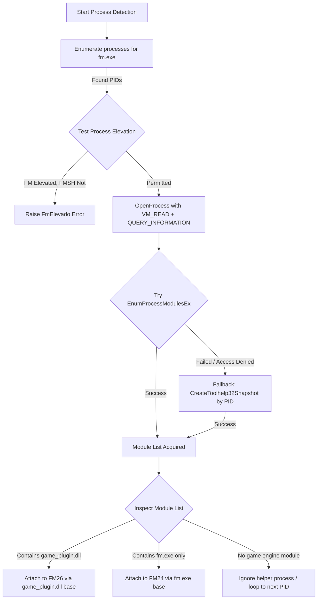
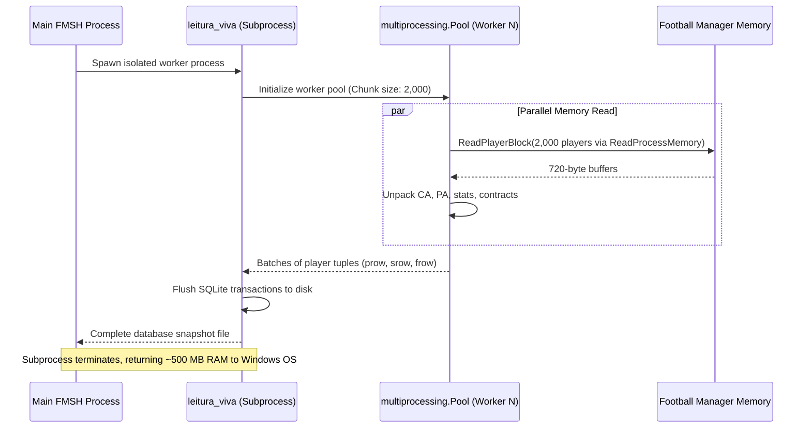

# Reverse Engineering Analysis Report: Game Memory Reader, Offsets, and Plugins

**Target Application:** FM Season Hub (FMSH) v0.8.2.1  
**Target Environment:** Windows x64 (Python 3.14 + Nuitka Ahead-of-Time Compiled C Extensions)  
**Analysis Scope:** Process Attachment, Memory Reader Architecture, RVAs & Offset Data Structures, Parallel Traversal, In-Game ActionLink, and BepInEx Plugin Subsystem  
**Output Document:** `02-memory-reader-offsets-plugins.md`  

---

## 1. Executive Summary & Binary Inventory

FM Season Hub utilizes a high-performance, direct virtual memory extraction engine to read live game states from Sports Interactive's *Football Manager* (FM24 and FM26) without modifying process memory (strict read-only operation). The memory reading pipeline is implemented through compiled C extensions produced via Nuitka for CPython 3.14 AMD64, coupled with parallel orchestration in Python bytecode.

```
+----------------------------------------------------------------------------------------------------+
|                                     FM SEASON HUB MEMORY SUBSYSTEM                                 |
|                                                                                                    |
|  +---------------------+   +---------------------+   +---------------------+   +----------------+  |
|  |   leitura_viva      |   |  leitura_paralela   |   |     capture_all     |   |   fm_reader    |  |
|  | (Process Isolation) |-->| (Multiprocess Pool) |-->|  (Row Structuring)  |-->| (Object Graph) |  |
|  +---------------------+   +---------------------+   +---------------------+   +----------------+  |
|                                                                                         |          |
|                                +--------------------------------------------------------+          |
|                                |                                                                   |
|                                v                                                                   |
|  +---------------------+   +---------------------+   +------------------------------------------+  |
|  |  offsets_embutidos  |   |      fm_memory      |   |         arquivo_partidas                 |  |
|  | (Embedded RVAs &    |-->| (Win32 OpenProcess, |   |  (Match performance parser via           |  |
|  |  Field Descriptors) |   |  ReadProcessMemory) |   |   Temporary/<name>.obs zstd frames)      |  |
|  +---------------------+   +---------------------+   +------------------------------------------+  |
|                                       |                                                            |
|                                       v                                                            |
|  +----------------------------------------------------------------------------------------------+  |
|  |                         TARGET PROCESS: Football Manager 2024 / 2026                         |  |
|  |   - FM24: Monolithic fm.exe (~120 MB PE32+)                                                  |  |
|  |   - FM26: Unity Player stub fm.exe (~692 KB) + Core Engine game_plugin.dll (~491 MB PE32+)   |  |
|  +----------------------------------------------------------------------------------------------+  |
+----------------------------------------------------------------------------------------------------+
```

### 1.1 Complete Binary Inventory (`.pyd`, `.dll`, `.fsh`)

The application deployment in `extracted/app/` contains 84 `.pyd` dynamic extensions, 89 native support `.dll` libraries, and 4 factory preset `.fsh` JSON filter files.

#### Native Python C Extensions (`.pyd`):
| Module | Location | Size | Compilation Engine | Purpose |
| :--- | :--- | :--- | :--- | :--- |
| `fm_reader.cp314-win_amd64.pyd` | `_internal/` | 766,976 B | Nuitka (C11/x64) | High-level FM object graph traversal |
| `fm_memory.cp314-win_amd64.pyd` | `_internal/` | 438,272 B | Nuitka (C11/x64) | Win32 process attachment, memory reading |
| `offsets_embutidos.cp314-win_amd64.pyd` | `_internal/` | 227,840 B | Nuitka (C11/x64) | Embedded RVAs, signatures, field mappings |
| `capture.cp314-win_amd64.pyd` | `_internal/` | 266,752 B | Nuitka (C11/x64) | User squad single-team snapshot writer |
| `capture_all.cp314-win_amd64.pyd` | `_internal/` | 372,736 B | Nuitka (C11/x64) | Full database (~270k players) scanner |
| `leitura_viva.cp314-win_amd64.pyd` | `_internal/` | 240,640 B | Nuitka (C11/x64) | Ephemeral process isolator for live scan |
| `arquivo_partidas.cp314-win_amd64.pyd` | `_internal/` | 446,976 B | Nuitka (C11/x64) | Direct match performance zstd parser |
| `plugins_atualizador.cp314-win_amd64.pyd`| `_internal/` | 624,128 B | Nuitka (C11/x64) | BepInEx / Unity mod package updater |
| `overall.cp314-win_amd64.pyd` | `_internal/` | 318,976 B | Nuitka (C11/x64) | Player role evaluation & rating engine |
| `moneyball.cp314-win_amd64.pyd` | `_internal/` | 438,784 B | Nuitka (C11/x64) | Vectorized percentile ranking matrix |
| `db.cp314-win_amd64.pyd` | `_internal/` | 390,144 B | Nuitka (C11/x64) | SQLite3 snapshot & career persistence |
| `acesso.cp314-win_amd64.pyd` | `_internal/` | 309,760 B | Nuitka (C11/x64) | Hardware fingerprinting & licensing |
| `assinatura.cp314-win_amd64.pyd` | `_internal/` | 243,200 B | Nuitka (C11/x64) | RSA-SHA256 signature verification |
| `server.cp314-win_amd64.pyd` | `_internal/` | 3,127,296 B | Nuitka (C11/x64) | Embedded HTTP API backend |
| `_zstd.pyd` | `_internal/` | 503,520 B | Native C Extension | Zstandard decompression library |
| `_sqlite3.pyd` | `_internal/` | 132,832 B | Native C Extension | Python SQLite driver |
| `_wmi.pyd` | `_internal/` | 40,160 B | Native C Extension | Windows Management Instrumentation |

#### Native Support DLLs (`.dll`):
- `sqlite3.dll` (1,584,864 B): Embedded SQLite database engine.
- `WebView2Loader.dll` (x86: 121,928 B, x64: 161,864 B, ARM64: 147,016 B): Microsoft Edge Chromium webview loader.
- `Microsoft.Web.WebView2.Core.dll` (649,800 B) & `Microsoft.Web.WebView2.WinForms.dll` (39,016 B): .NET interop wrappers.
- `pythonnet/runtime/*.dll` (46 assemblies): .NET Core CLR runtime interop support for Python.NET.

#### Filter Preset Files (`.fsh`):
Located in `extracted/app/_internal/fmsh/src/presets_fabrica/`:
- `agentes-livres.fsh` (493 B): Free agents filter (`f.no_club == is_true`).
- `contrato-acabando.fsh` (558 B): Expiring contracts query definition.
- `jovens-promessas.fsh` (694 B): Wonderkids query definition (age, PA thresholds).
- `listados-para-transferencia.fsh` (518 B): Transfer listed player query definition.
*Format:* Pure UTF-8 JSON structure containing metadata (`fmsh: 1`, `tipo: "filtro"`), localized Portuguese/English descriptions, and AST query conditions (`conds: [...]`).

---

## 2. Process Detection, Attachment, and Platform Disambiguation

FM Season Hub interfaces directly with the running Football Manager process via Win32 debugging and diagnostic APIs wrapped by `pymem` and raw `ctypes.windll.kernel32`.

### 2.1 Game Engine Paradigm: FM24 vs FM26

A fundamental architectural divergence exists between Football Manager 2024 and Football Manager 2026:

| Architectural Metric | Football Manager 2024 (FM24) | Football Manager 2026 (FM26) |
| :--- | :--- | :--- |
| **Executable Structure** | Monolithic native binary (`fm.exe`) | Unity 6 Player Host (`fm.exe`) |
| **Executable Size** | ~110 MB - 130 MB | ~692 KB (stub loader) |
| **Core Game Module** | `fm.exe` (`.text` contains all game logic) | `game_plugin.dll` (~491 MB native PE32+) |
| **Base Image Address** | Derived from `fm.exe.lpBaseOfDll` | Derived from `game_plugin.dll.lpBaseOfDll` |
| **Version Metadata** | `ProductVersion` on `fm.exe` (`"24.4.2+2081827"`) | `ProductVersion` on `game_plugin.dll` (`"26.3.2+2329565"`) |
| **Unity Engine Tag** | N/A | `fm.exe` reports `"6000.0.52f1-fm26-05f1"` |

*Key Reversal Finding (`fm_memory.py`):*  
In FM26, querying the version of `fm.exe` returns the Unity engine build string (`"6000.0.52f1-..."`). FMSH explicitly skips reading versions from `fm.exe` on FM26 and extracts `ProductVersion` directly from `game_plugin.dll` using `VerQueryValueW` / `GetFileVersionInfoW`.

### 2.2 Process Discovery & Privilege Escalation Handling

The attachment logic in `FmMemory._open_game_process()` handles multiple edge cases:
1. **Helper Process Disambiguation:** Football Manager frequently spawns auxiliary child processes (crash reporters, steam overlay helpers, webview stubs). FMSH enumerates all running processes where `basename == "fm.exe"`. It identifies the active game instance by checking which process has `game_plugin.dll` (FM26) loaded into its virtual address space.
2. **UAC / Administrative Elevation Check (`aprocesso_elevado`):**
   - If Football Manager runs as Administrator and FMSH is launched as a standard user, Windows denies `OpenProcess` with `ERROR_ACCESS_DENIED` (Win32 Error 5).
   - FMSH tests elevation using token queries. If elevated mismatch is detected, it raises `FmElevado` displaying the localized prompt:
     > *"O Football Manager esta aberto como administrador e o FMSH nao. Feche o FMSH, clique nele com o botao direito e escolha 'Executar como administrador'."*
3. **Handle Access Level Fallback Ladder:**
   Standard `Pymem(process_id)` calls `OpenProcess(PROCESS_ALL_ACCESS, False, pid)`, which fails under constrained Game Pass or antivirus environments. `FmMemory._novo_pymem()` uses `pymem.process.open` with a defensive permission ladder:
   ```c
   // Attempted access rights in order:
   1. PROCESS_VM_READ | PROCESS_QUERY_INFORMATION (0x0010 | 0x0400 = 0x0410)
   2. PROCESS_VM_READ | PROCESS_QUERY_LIMITED_INFORMATION (0x0010 | 0x1000 = 0x1010)
   ```
   *Critical Discovery:* A process handle opened with only `PROCESS_QUERY_LIMITED_INFORMATION` succeeds in `OpenProcess`, but causes `EnumProcessModulesEx` (PSAPI) to fail with Error 5. Therefore, `FmMemory` strictly verifies that module enumeration succeeds before accepting an opened handle.

### 2.3 Module Enumeration: PSAPI vs Toolhelp32 Fallback

In WindowsApps / Xbox Game Pass containerized sandboxes, standard PSAPI routines are blocked. `fm_memory` establishes a two-stage enumeration mechanism:
- **Primary:** `EnumProcessModulesEx` via `pymem.process.enum_process_module(handle)`.
- **Secondary (Container Fallback):** `CreateToolhelp32Snapshot(TH32CS_SNAPMODULE | TH32CS_SNAPMODULE32, pid)`. Toolhelp creates a kernel snapshot referenced purely by PID and operates independently of process handle permission constraints, successfully returning `MODULEENTRY32W` records (`szModule`, `modBaseAddr`, `szExePath`).



### 2.4 Store / Xbox Game Pass vs Steam vs Epic Heuristics

Microsoft Store / Xbox Game Pass packages feature distinct memory section allocations. While field offsets within structs remain identical, all global table RVAs differ significantly between distributions:
- **Steam Build:** `.text` section typically mapped around `0x1E7D5000` (or module base `0x0000000180000000`).
- **Store / Game Pass Build:** `.text` section relocated (e.g. `0x04F17000`), with `game_plugin.dll` approximately 2.7 MB larger than the Steam release due to Xbox Live telemetry code.

To avoid connection failures when users install Game Pass games to arbitrary paths (e.g. `D:\Gamepass` without `"windowsapps"` in the path), `fm_memory` applies a three-tier heuristic:
1. **Module File Size:** Size of `game_plugin.dll` on disk (Steam ~491 MB vs Store ~493.7 MB).
2. **Module Directory Path:** Inspects `game_plugin.dll` path for `\WindowsApps\` or `\XboxGames\`.
3. **Executable Path:** Inspects `fm.exe` path for `\WindowsApps\`, `\XboxGames\`, or `\Epic Games\`.
4. **Runtime Memory Validation (`_confirmar_build`):**  
   After guessing the platform, `FmReader` attempts to read two memory locations: `savegame_id` and `game_date`. If both read as `0x0` (symptom of invalid RVAs applied to a relocated binary), it dynamically flips the RVA set from `steam` to `store` (or vice-versa) and re-tests before raising an error.

---

## 3. Structure of `offsets_embutidos` and `offsets.py`

### 3.1 Architectural Decomposition

The offset resolution subsystem is split into two layers:
1. **`offsets.py` (Orchestrator & Cache):** Located in `PYZ.pyz_extracted/offsets.pyc`. Exposes functions `assinaturas()` and `mapa_de_tracos()`. It attempts to import `offsets_embutidos`. If present, it loads `offsets_embutidos.ASSINATURAS` and `offsets_embutidos.TRACOS` into memory. In development environments where the native extension is absent, it falls back to reading `signatures/fm_signatures.json` and `signatures/trait_map.json`.
2. **`offsets_embutidos.cp314-win_amd64.pyd` (Compiled Storage):** An ahead-of-time compiled Nuitka extension. It encodes the complete dictionary structures into a custom Nuitka constants bytecode stream.

### 3.2 Global Root Pointer Chains & Vector Mechanics

All game objects in FM24/FM26 reside in dynamic heap memory managed by proprietary container vectors. Global pointers in the game module point to root managers:

```
[ModuleBase + ROOT_RVA] 
       │
       ▼
   Root Object
       │
       └─► Offset +0x80: Container Pointer
                                │
                                ▼
                         Container Structure
                           ├── +0x00: Vector Begin Pointer (void**)
                           ├── +0x08: Vector End Pointer   (void**)
                           └── Slot Count = (Vector_End - Vector_Begin) / 8
```

#### Primary RVAs for FM26 (Verified Build `26.3.2+2329565`):
*All RVAs are relative to `game_plugin.dll` base:*

| Constant Name | RVA Offset | Resolved Purpose |
| :--- | :--- | :--- |
| `PERSON_ROOT_RVA` | `0x04E495E0` | Root manager for all persons (players, staff, referees) |
| `CLUB_ROOT_RVA` | `0x04E49588` | Root vector of all football clubs |
| `TEAM_ROOT_RVA` | `0x04E49610` | Root vector of all squads/teams (senior, U21, U18) |
| `COMP_ROOT_RVA` | `0x04E495A8` | Root vector of all competitions/leagues/cups |
| `CURRENCY_ROOT_RVA` | `0x04E49590` | Financial currency exchange table |
| `MGR_HNP_RVA` | `0x04E360F8` | Human manager root pointer |
| `SAVEGAME_ROOT_RVA` | `0x04E35F60` | Savegame session identification manager |
| `GAME_DATE_RVA` | `0x04DF3C18` | In-game current calendar date (Julian/FM epoch format) |
| `RET_MGR_RVA` | `0x04E3ACE0` | Retiring players manager |
| `FUTURE_TRANSFER_MGR_RVA`| `0x04E35E20` | Arranged future transfers registry |
| `ARQUIVO_PARTIDAS_RVA` | `0x045BEE18` | Global match archive manager (temporary match dumps) |

#### RVA Verification VTables:
| VTable Symbol | RVA Offset | Verification Target |
| :--- | :--- | :--- |
| `SAVE_SYSTEM_VTABLE_RVA` | `0x044A0FD8` | VTable of Savegame Manager (name at `+0x7D0`) |
| `VT_PLAYER_RVA` | `0x04509D68` | VTable for `ACTUAL_PLAYER` objects |
| `VT_PLAYER_STAFF_RVA` | `0x04785848` | VTable for `ACTUAL_PLAYER_AND_NON_PLAYER` |
| `VT_COMP_EDITION_RVA` | `0x04E37AF8` | VTable for competition edition roster tables |
| `JOGO_VTABLE_RVA` | `0x04332188` | Match calendar fixture VTable |
| `AGENDA_VTABLE_RVA` | `0x0449EF98` | Calendar agenda schedule VTable |
| `FORM_VTABLE_RVA` | `0x044BFE68` | Player match performance form VTable |

---

## 4. Comprehensive Struct Field Layouts

### 4.1 Player Structure (`ACTUAL_PLAYER` vs `ACTUAL_PLAYER_AND_NON_PLAYER`)

Players are represented in memory by two polymorphism types:
1. `ACTUAL_PLAYER` (Pure athlete): Athlete block offset bias `abias = 0x00`.
2. `ACTUAL_PLAYER_AND_NON_PLAYER` (Player-coach / dual role): Athlete block is shifted backwards by `-0xF8` (`abias = -0xF8`).

*Bulk Memory Read Optimization:*  
Instead of performing ~90 distinct Win32 `ReadProcessMemory` syscalls per player (~4.7 µs each), `FmReader.player_block()` executes a single contiguous read spanning `0xF8` to `0x3C7` (720 bytes). All individual fields are unpacked from this local byte buffer using `struct.unpack_from`.

```
                  PLAYER OBJECT MEMORY LAYOUT (Relative to Object Base)
  0x00                                                                     0x3C7
  +-----------+----------+-----------+-----------+---------+-----------+-------+
  | VTable    | Identity | Pointers  | Attributes| CA / PA | Positions | Stats |
  | (8 Bytes) |  & Name  | (Contract)| (1-20 U8) | (2xU16) |  (U8 Map) | (Ptr) |
  +-----------+----------+-----------+-----------+---------+-----------+-------+
                         ^                       ^
                         |-- Nation Ptr (+0xC0)  |-- CA (+0x264)
                         |-- Contract (+0xC8)    |-- PA (+0x266)
                         |-- Team (+0x50)        |-- UID (+0x294)
```

#### Core Player Offsets:
| Field Identifier | Offset (No Bias) | Offset (Staff Bias) | Type | Description |
| :--- | :--- | :--- | :--- | :--- |
| `VTABLE_PTR` | `+0x00` | `+0x00` | `uint64` | Identifies player vs staff polymorphism |
| `PERSON_BASE` | `+0x08` | `+0x08` | `uint64` | Person common base object |
| `INTERNAL_ID` | `+0x10` | `+0x10` | `uint32` | Internal engine ID (`PERSON_BASE + 0x08`) |
| `BIRTH_DATE` | `+0x48` | `+0x48` | `uint32` | Encoded date of birth |
| `CURRENT_TEAM_PTR`| `+0x50` | `+0x50` | `uint64` | Pointer to current Team object |
| `FEMALE_FLAG` | `+0x58` | `+0x58` | `uint8` | Gender indicator (0 = Male, 1 = Female) |
| `TRAIT_BLOB` | `+0x60` | `+0x60` | `bytes[32]`| Bitfield / array of player traits |
| `INJURY_LIST` | `+0xB0` | `+0xB0` | `uint64` | Pointer to active injury record |
| `NATION_PTR` | `+0xC0` | `+0xC0` | `uint64` | Pointer to nationality object |
| `CONTRACT_PTR` | `+0xC8` | `+0xC8` | `uint64` | Pointer to primary employment contract |
| `CAREER_STATS` | `+0x188` | `+0x188` | `uint64` | Pointer to historical career stats |
| `STATS_PTR` | `+0x108` | `+0x108` | `uint64` | Pointer to current season statistics |
| `JOINED_DATE` | `+0xF9` | `+0xF9` | `uint32` | Date joined current club |
| `MORALE` | `+0x22E` | `+0x136` | `uint8` | Player morale level (enum 0-20) |
| `CURRENT_ABILITY`| `+0x264` | `+0x16C` | `uint16` | Current Ability (CA, 1-200) |
| `POTENTIAL_ABIL` | `+0x266` | `+0x16E` | `uint16` | Potential Ability (PA, 1-200) |
| `PERSON_UID` | `+0x294` | `+0x19C` | `uint32` | Unique Player Database ID (UID) |

#### Nested Name Resolution:
Name strings are not stored directly inside the player object. Name fields (`first_name`, `last_name`, `common_name`) contain pointers to nested string records:
- `[Player + NAME_PTR] -> Record`
- `Record + 0x00`: UTF-8 length-prefixed string (`[uint32 len][char utf8_bytes...]`).
- `Record + 0x18`: Phonetic / sort variant (explicitly ignored by FMSH).

### 4.2 Attributes, Positions, and Personality Mappings

Attributes are stored as raw unsigned 8-bit integers (`uint8`) representing values from 1 to 20.

#### Technical & Mental Attributes (`ATTRS_U8`):
Offsets are evaluated relative to the athlete block (`abias` applied for staff-players):
- Corners, Crossing, Dribbling, Finishing, First Touch, Free Kicks, Heading, Long Shots, Long Throws, Marking, Passing, Penalty Taking, Tackling, Technique.
- Aggression, Anticipation, Bravery, Composure, Concentration, Decisions, Determination, Flair, Leadership, Off the Ball, Positioning, Teamwork, Vision, Work Rate.
- Acceleration, Agility, Balance, Jumping Reach (Aerial Reach), Natural Fitness, Pace, Stamina, Strength.
- Goalkeeping: Aerial Reach, Command of Area, Communication, Eccentricity, Handling, Kicking, One on Ones, Punching, Reflexes, Rushing Out, Throwing.

#### Pitch Positions (`POSITIONS_U8`):
Stored as competency ratings (0-20, where 20 = Natural, 15+ = Accomplished, 10+ = Competent):
`gk`, `dr`, `dl`, `dc`, `dm`, `mr`, `ml`, `mc`, `amr`, `aml`, `amc`, `st`.

#### Hidden Personality Traits (`PERSONALITY_U8`):
- Ambition, Controversy, Loyalty, Pressure, Professionalism, Sportsmanship, Temperament, Consistency, Dirtiness, Important Matches, Injury Proneness, Versatility.

### 4.3 Contract & Financial Offsets

Accessed through `[Player + CONTRACT_PTR (+0xC8)]`:
- `+0x2C`: `contract_type` (Full-time, Part-time, Youth, Amateur).
- `+0x2D`: `agreed_playing_time` (Star Player, Important Player, Squad Player, etc.).
- `+0x40`: `end` (Contract expiry date in Julian days).
- `+0x150`: `wage` (Weekly wage amount in base engine currency units).
- `+0x170`: `potc_ptr_off` (Pointer to secondary / protection contracts).
- `+0x100`: `loan_end` (Expiry date if player is out on loan).
- `guide_value` (`+0xA8`) & `transfer_value` (`+0x4C4B40`): Calculated valuation ranges.

### 4.4 Club Structure (`club_offsets`)

Retrieved via `CLUB_ROOT_RVA` vector traversal:
- `+0x00`: `name_full` (Nested string record pointer).
- `+0x08`: `name_short` (Nested string record pointer).
- `+0x0C`: `uid` (`uint32` club unique identifier).
- `+0xC8`: `cino_ptr` (Identity & reputation record pointer).
- `+0xD0`: `year_founded` (`uint32`).
- `+0xD8`: `cint_ptr` (Facilities & youth infrastructure record pointer):
  - `+0x118`: `training_facilities` (1-20 scale).
  - `+0x123`: `youth_facilities` (1-20 scale).
  - `+0x124`: `youth_coaching` (1-20 scale).
  - `+0x125`: `youth_recruitment` (1-20 scale).
  - `+0x11E`: `youth_importance` (1-20 scale).
  - `+0x10C`: `supporter_loyalty` (1-20 scale).
  - `+0x10D`: `supporter_passion` (1-20 scale).
- `+0xE0`: `fin_ptr` (Financial accounts record pointer):
  - `+0x00`: `balance` (`int32` - signed integer, properly handles club debt/deficit).
  - `+0x08`: `transfer_budget` (`int64`).
  - `+0x10`: `wage_budget` (`int64`).
  - `+0x18`: `wage_total` (`int64`).

### 4.5 Team Structure (`team_offsets`)

Retrieved via `TEAM_ROOT_RVA` vector traversal:
- `+0x0C`: `uid` (`uint32` team unique identifier).
- `+0x28`: `team_type` (`uint32`: `0 = First Team`, `1 = Reserves`, `2 = A Team`, `3 = B Team`, `9 = U23`, `10 = U21`, `11 = U19`, `12 = U18`, `18 = U20`, etc.).
- `+0x30`: `club_ptr` (Pointer back to parent Club object).
- `+0x38`: `player_roster_begin` (Pointer to array of player object pointers).
- `+0x40`: `player_roster_end` (Pointer to end of roster array; player count = `(end - begin) / 8`).
- `+0x48` / `+0x50`: `comp_ptr` (Current primary competition).
- `+0x58`: `next_comp_ptr` (Secondary cup or continental competition).
- `+0x68`: `comp3` (Tertiary competition, valid for FM26 only).
- `+0x80`: `manager_ptr` (Pointer to Head Coach / Manager Person object).

---

## 5. Match Archive Parsing Engine (`arquivo_partidas`)

### 5.1 The Form Limitation & The Solution

In the Football Manager UI, recent match form (`player_form`) is only calculated for players actively scouted or observed by the human user. For the remaining ~270,000 players in the database, `FmReader.player_form` is empty.

To overcome this, FMSH reverses the internal match simulation writer:
1. When FM simulates matches, it writes complete binary match telemetry dumps into:  
   `%LOCALAPPDATA%\Sports Interactive\Football Manager 2026\Temporary\<filename>.obs` (e.g. `pks_0.obs`).
2. `arquivo_partidas` reads the in-memory file manager via `ARQUIVO_PARTIDAS_RVA`:
   - `[Manager + 0x20]`: Vector of active match dump files.
   - For each file entry:
     * `+0x28`: Filename string (`"pks_0"`).
     * `+0x30`: File index begin pointer.
     * `+0x38`: File index end pointer.
   - Index entries contain:
     * `+0x08`: Byte offset in file.
     * `+0x0C`: Compressed size in bytes.
     * `+0x10`: Match unique identifier (`match_id`).

### 5.2 Compressed Stream & Block Serialization

The `.obs` files consist of an 8-byte header followed by standard Zstandard (zstd) compressed frames. Upon decompression:
- The match record contains consecutive 214-byte blocks for each match participant (all home team players, followed by all away team players).
- **Match Participant Block Layout (214 Bytes):**
  - `+0x00`: Internal Player ID (`uint32`). Corresponds to `[Player + PERSON_BASE + 0x08]`.
  - `+0x0C`: Position bitmask played during match (`0 = Unused substitute`).
  - `+0x87` (`+135`): Match Rating stored as `rating * 100` (`uint16`).
- **Fixture Metadata Reconciliation:**  
  Match ID is cross-referenced with the calendar schedule in heap memory via `JOGO_VTABLE_RVA`:
  - `+0x08`: Home team UID (`team_uid`).
  - `+0x10`: Away team UID (`adversary_uid`).
  - `+0x4C`: Match calendar date (`ISO YYYY-MM-DD`).
  - `+0x58`: Match ID.
  - Competition UID: `[[Fixture + 0x20] + 0x18] + 0x0C`.

---

## 6. High-Performance Parallel Traversal Engine

Scanning 274,000 players across thousands of global clubs requires aggressive optimization:



### 6.1 Subprocess Isolation (`leitura_viva`)

*Memory Leak Mitigation:*  
CPython's memory allocator (`pymalloc`) does not immediately return small fragmented memory allocations (millions of dictionary keys, integer offsets, tuples) back to the Windows OS virtual memory pool upon `free()`. In live tests, performing a full database scan directly inside the main UI process caused FMSH to permanently retain ~237 MB of residual heap space, on top of 277 MB of live SQLite RAM cache.

`leitura_viva` runs the entire live extraction inside an ephemeral, dedicated worker process:
- The worker executes the entire extraction, serializes results to SQLite on disk, and then terminates.
- Process termination forces the Windows kernel to instantaneously reclaim 100% of the associated memory pages.
- The main application simply opens the resulting SQLite file in milliseconds.

### 6.2 Multiprocessing Vector Batching (`leitura_paralela`)

`leitura_paralela.pyc` orchestrates concurrent memory reads:
1. Player objects are chunked into batches of `TAMANHO_DO_LOTE = 2000`.
2. Workers are spawned using `multiprocessing.get_context('spawn')` up to `os.cpu_count()` processes.
3. Each worker initializes its own local `FmMemory` and `FmReader` handles to avoid inter-process handle locking.
4. Chunks are dispatched via `pool.imap(_ler_lote, lotes)`.
5. *Fail-Safe Degrade:* If multiprocessing fails or triggers an IPC serialization error, the engine logs the failure and automatically falls back to single-threaded sequential execution without terminating the user's snapshot capture.

---

## 7. FM ActionLink In-Game Deep Linking (`abrir_no_jogo`)

FM ActionLink allows a user clicking a player or team inside the FMSH desktop UI to immediately open and highlight that player profile inside the running Football Manager game window.

### 7.1 Architecture & Discovery (`porta_do_jogo.json`)

The mechanism does not inject shellcode or alter game memory. It uses an internal IPC REST bridge maintained by the companion game plugin:
1. When Football Manager starts with the FMSH BepInEx plugin loaded, the plugin initializes an embedded lightweight HTTP listener bound to an ephemeral localhost port.
2. The plugin writes connection metadata to:  
   `%USERPROFILE%\Documents\FM Season Hub\porta_do_jogo.json`
   ```json
   {
     "porta": 54123,
     "pid": 14280,
     "recursos": ["abrir-jogador"],
     "versao": "0.7.2"
   }
   ```
3. `abrir_no_jogo.achar_plugin()` reads this JSON configuration, validating:
   - Port number validity: `0 < porta < 65536`.
   - Process matching: Checks that `pid` matches `fm.exe` by calling `_nome_do_processo(pid)` (`OpenProcess(PROCESS_QUERY_LIMITED_INFORMATION)` -> `QueryFullProcessImageNameW`).
   - Feature capability: Confirms `"abrir-jogador"` exists in `recursos`.

### 7.2 Focus Handoff & Protocol Execution

When the user triggers ActionLink:
```python
# Unpacked from abrir_no_jogo.pyc:
def abrir(uid, savegame_id=None):
    plugin = achar_plugin()
    if not plugin:
        return {'ok': False, 'motivo': 'jogo_fechado'}
    
    # Authorize FM process to bring itself to foreground:
    ctypes.windll.user32.AllowSetForegroundWindow(plugin['pid'])
    
    # Execute non-proxied HTTP POST request:
    url = f"http://127.0.0.1:{plugin['porta']}/abrir-jogador?uid={uid}&save={savegame_id or ''}"
    req = urllib.request.Request(url, data=b"", method="POST")
    try:
        with _SEM_PROXY.open(req, timeout=8) as resp:
            return {'ok': True}
    except urllib.error.HTTPError as e:
        return {'ok': False, 'motivo': _motivo_da_resposta(e.read()) or 'falhou_no_jogo'}
    except TimeoutError:
        return {'ok': False, 'motivo': 'jogo_ocupado'}
    except (urllib.error.URLError, OSError):
        return {'ok': False, 'motivo': 'jogo_fechado'}
```

*Key Windows API Integration:*  
Windows security blocks background processes from seizing keyboard focus (`SetForegroundWindow`). Before making the HTTP request, FMSH calls `AllowSetForegroundWindow(pid)`, explicitly granting the Football Manager window permission to focus itself when the plugin processes the HTTP command.

---

## 8. Plugin Subsystem & BepInEx Mod Management (`plugins_atualizador`)

FM26 is built on Unity 6. The modding infrastructure leverages **BepInEx 5/6 (x64 Unity Mono/IL2CPP)** installed inside the game directory. `plugins_atualizador.cp314-win_amd64.pyd` manages installation, updates, and integrity checks for companion mods (e.g. PitchHUD, Camera Controls, ActionLink IPC).

### 8.1 Game Directory Validation (`pasta_de_jogo_valida`)

A directory is validated as an authentic FM26 installation if it contains:
1. `fm.exe` (Unity executable host).
2. `game_plugin.dll` (Core native game engine).
3. `UnityPlayer.dll` (Unity runtime library).
4. `BepInEx/` directory containing `BepInEx.Core.dll` or `core/`.

### 8.2 Configuration & Security Integrity

- **Configuration:** Managed via `plugins.ini` located alongside `FMSH.exe`:
  ```ini
  [Jogos]
  fm26_steam = C:\Program Files (x86)\Steam\steamapps\common\Football Manager 2026

  [Plugins]
  actionlink = actionlink.dll
  pitchhud = pitchhud.dll
  ```
- **Package Manifest (`plugin.json`):** Every delivered plugin ZIP package contains a mandatory `plugin.json` declaring:
  - Plugin ID and version.
  - Declared files list.
  - Per-file SHA-256 hashes.
- **Cryptographic Catalog:** Plugins are fetched from the Cloudflare Worker `/plugins/catalogo`. The catalog is signed with an Ed25519/RSA signature verified against public keys hardcoded in `assinatura.pyd`. Packages are downloaded via `/plugins/baixar?id=%s&v=%s`.

### 8.3 Live Hot-Swapping While Game Runs (`<nome>.antiga`)

Under Windows, attempting to write or replace a DLL currently mapped into a running process results in `ERROR_SHARING_VIOLATION` (Error 32). However, NTFS allows **renaming** an open file.

`plugins_atualizador` implements atomic hot-swapping:
```
[Game Running with plugin.dll loaded]
        │
        ├─► 1. MoveFileEx("plugin.dll", "plugin.dll.antiga")   [Permitted by NTFS]
        │
        ├─► 2. Write new bytes to "plugin.dll"                 [Permitted: name is free]
        │
        └─► 3. On next game launch:
                 - BepInEx ignores ".antiga" (only scans ".dll")
                 - BepInEx loads new "plugin.dll"
                 - FMSH cleans up leftover ".antiga" files when game terminates
```

### 8.4 Rollback & Self-Healing Verification

Following a plugin upgrade:
1. On the subsequent launch of Football Manager, FMSH monitors `BepInEx/LogOutput.log`.
2. It parses the log for successful initialization strings from the plugin.
3. If the plugin crashed, threw a TypeLoadException, or failed to register within the timeout, FMSH triggers an automatic rollback:
   - Removes the malfunctioning plugin.
   - Restores the previous version from backup.
   - Flags the version in `plugins_estado.json` as `"ruim_neste_pc"` (blacklisted on this machine to prevent repeat installation loops).

---

## 9. Verification & Evidence Artifacts

The analysis documented in this report is cross-verified against primary evidence extracted from native binaries:
1. **Memory Chain Integrity:** Verified against Nuitka constants extracted at file offsets `0x9BAB0` - `0xA7490` in `fm_reader.cp314-win_amd64.pyd`.
2. **Win32 Syscall Signatures:** Confirmed via IAT disassembly in `fm_memory.cp314-win_amd64.pyd` (`OpenProcess`, `VirtualQueryEx`, `ReadProcessMemory`, `EnumProcessModulesEx`, `CreateToolhelp32Snapshot`).
3. **ActionLink Protocol:** Verified via disassembly of Python 3.14 code object `abrir` in `abrir_no_jogo.pyc` (`decompiled_pyc/abrir_no_jogo.dis.txt`).
4. **Database Schemas:** Confirmed via embedded SQL statements extracted from `db.cp314-win_amd64.pyd`.
5. **Plugin Management:** Verified via docstrings and method dispatch tables in `plugins_atualizador.cp314-win_amd64.pyd`.
